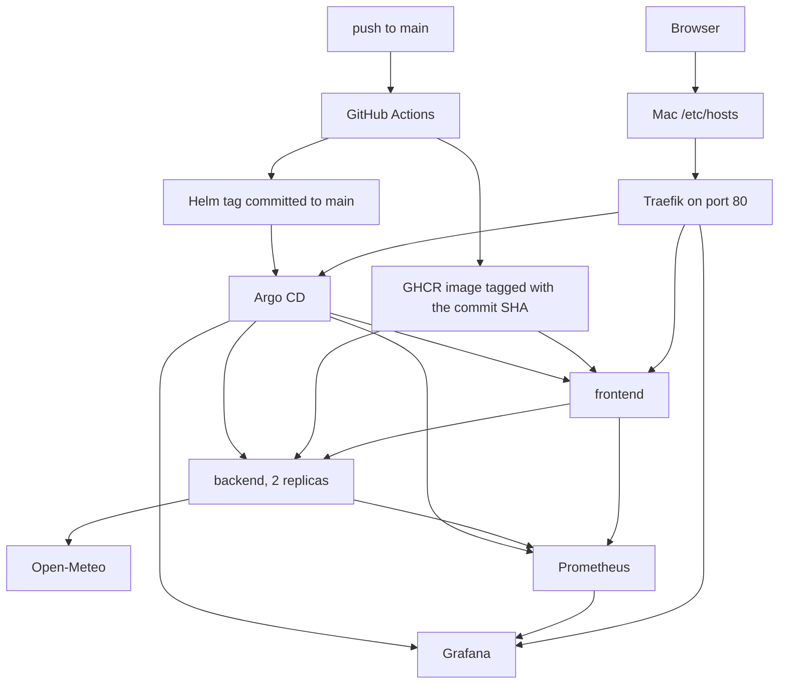

# SkyWatch

SkyWatch is a two-service weather app on a local Kubernetes cluster. The frontend asks the backend for a city, and the backend calls Open-Meteo. GitHub Actions publishes the images. Argo CD deploys what is on `main`.

## Architecture

Three Multipass VMs run K3s. Ansible on the Mac creates them and installs Argo CD. After that, a push to `main` is the deploy.



A city lookup goes browser, Traefik, frontend, backend, Open-Meteo. Traefik also serves Grafana and Argo CD. Both apps expose `/metrics`. Prometheus scrapes them, and Grafana reads Prometheus.

The VMs are `skywatch-cp`, `skywatch-w1`, and `skywatch-w2`. The control plane is tainted `node-role.kubernetes.io/control-plane:NoSchedule` so application pods stay on the workers. K3s ships Traefik, which is the ingress class for all three names.

## Prerequisites

On the Mac:

- [Multipass](https://multipass.run/)
- Ansible
- `kubectl`

The three VMs use 2560 MB each.

The cluster pulls `ghcr.io/<github-owner>/skywatch-frontend` and `skywatch-backend`. Those GHCR packages must be public. Open-Meteo does not use an API key, so the chart has no image pull secret and no application Secret.

## How to start

```bash
git clone https://github.com/sharondescalo/speedata-home-assignments.git
cd speedata-home-assignments/provision
ansible-playbook site.yml
ansible-playbook dns.yml --ask-become-pass
```

`site.yml` creates the VMs, installs the pinned K3s, writes a `skywatch` kube context, installs Argo CD, and applies the `speedata-apps` root. Run that command as written. The VMs already have passwordless sudo, and a Mac sudo password on those plays makes fact gathering hang.

`dns.yml` is the only playbook that edits the Mac hosts file. It asks for your Mac password and adds:

```text
skywatch.test grafana.skywatch.test argocd.skywatch.test
```

The address is the `192.168.252` address of `skywatch-w1`. Traefik listens on port 80 and routes each name to its Service.

Argo CD then syncs `main`. The first sync pulls the images and starts Prometheus, so give it a few minutes. Confirm with:

```bash
kubectl --context skywatch get applications.argoproj.io -n argocd
kubectl --context skywatch get pods -A
```

`skywatch-frontend`, `skywatch-backend`, `monitoring`, and `speedata-apps` should be Synced and Healthy. Then open:

| Name | URL |
| --- | --- |
| SkyWatch | http://skywatch.test |
| Grafana | http://grafana.skywatch.test |
| Argo CD | http://argocd.skywatch.test |

The service-health dashboard is http://grafana.skywatch.test/d/skywatch/skywatch. Grafana signs in as an anonymous admin. Argo CD uses the user `admin`. The password is the initial admin secret:

```bash
kubectl --context skywatch -n argocd get secret argocd-initial-admin-secret -o jsonpath='{.data.password}' | base64 -d; echo
```

Look up a city on http://skywatch.test. Running `site.yml` again is safe. Existing VMs are kept, and K3s is installed only when the pinned version is missing.

## Tear down

```bash
cd provision
ansible-playbook teardown.yml --ask-become-pass
```

This removes the SkyWatch block from `/etc/hosts`, deletes the three VMs, and deletes the `skywatch` kube context.

## GitOps

`gitops/speedata-apps.yaml` is the root Application. It watches `gitops/apps` on `main` and creates the child apps. A push to `main` is the only app deploy step. Argo CD polls, syncs, prunes, and self-heals. A `kubectl apply` on your laptop is overwritten on the next sync.

| Application | What it deploys |
| --- | --- |
| `skywatch-frontend` | Frontend half of `helm/skywatch`, namespace `prod` |
| `skywatch-backend` | Backend half of the same chart, namespace `prod`, 2 replicas |
| `monitoring` | `kube-prometheus-stack` plus the SkyWatch dashboard, namespace `monitoring` |

The root file stays outside `gitops/apps`, so it does not manage itself.

## CI

`.github/workflows/ci.yml` has four jobs.

| Job | When | What |
| --- | --- | --- |
| `lint` | every pull request, and pushes to `main` that touch `apps/**` or the workflow | `ruff check apps` |
| `test` | same | `unittest` for the frontend and the backend |
| `images` | push to `main` only, after lint and test | build `linux/amd64` and `linux/arm64`, push `ghcr.io/<owner>/skywatch-<name>:<git sha>` |
| `tags` | after the images | write that SHA into the two `tag:` lines in `helm/skywatch/values.yaml` and push to `main` |

Pull requests run lint and test only. They do not publish images.

The tag commit message contains `[skip ci]`, and image builds run only when `apps/**` or the workflow file changes. The tag commit touches neither path, so it does not start another build. `concurrency` cancels a superseded run on the same ref. pip and Buildx use the GitHub Actions cache.

## Helm and Kubernetes

One chart, `helm/skywatch`, renders both services. Each Argo CD app sets `frontend.enabled` or `backend.enabled` so the two releases do not fight over the same objects. The frontend Service is a NodePort on 30080 and also has a Traefik Ingress for `skywatch.test`. The backend Service is ClusterIP only. The frontend reaches it at `http://skywatch-backend:8000`.

Both Deployments probe `/healthz` and `/readyz`, set CPU and memory requests and limits, and run as uid 10001. Prometheus scrapes `/metrics` through ServiceMonitors. The ServiceMonitor CRDs come from the monitoring app, which syncs first.

Open-Meteo needs no credential. Configuration that would be a Secret in another app is a ConfigMap here, because none of it is secret.

Grafana's memory limit is 768Mi. The chart default of 256Mi is too small for the Grafana version this stack installs, and the process is killed.

## Code

Both apps read their settings from the environment. The chart's ConfigMaps set the in-cluster values.

| Variable | Service | Role |
| --- | --- | --- |
| `BACKEND_URL` | frontend | Backend base URL |
| `REQUEST_TIMEOUT_SECONDS` | both | HTTP timeout |
| `GEOCODING_API_URL` | backend | Open-Meteo geocoding |
| `FORECAST_API_URL` | backend | Open-Meteo forecast |
| `PORT` | both | Listen port, 8080 or 8000 |


## Test script to make some traffic

`scripts/dashboard-traffic.sh` posts city lookups to http://skywatch.test. Each lookup hits the frontend and, through it, `/api/weather` on the backend. One city in the list does not exist, so the backend records 404s. The script does not call the health probes. Those panels ignore `/healthz` and `/readyz`.

```bash
scripts/dashboard-traffic.sh
REQUESTS=120 PAUSE=0.05 scripts/dashboard-traffic.sh
```

The rate and latency panels use a five-minute window. User p95 turns yellow above 0.5s and red above 1s. A city lookup spends most of that time waiting on Open-Meteo.
